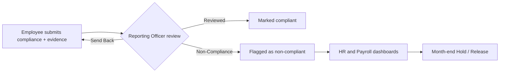

<div align="center">

# 🏢 Workspace Compliance

**A role-based compliance tracking platform with review workflows, dashboards and payroll scheduling**


<!--  -->

</div>

---

## 📖 Overview

**Workspace Compliance** is a React.js web application for tracking **weekly and monthly compliance** across an organisation. Each user sees a view built for their role, from employees submitting evidence to HR and Payroll teams monitoring non-compliance and acting on it at month-end.

## 👥 Roles

| Role | What they do |
|---|---|
| 🧑‍💼 **Employee** | Submits compliance entries and uploads evidence |
| 🕵️ **Reporting Officer (RO)** | Reviews submissions: **Reviewed**, **Send Back** or **Non-Compliance** |
| 🧑‍💻 **HR** | Monitors live non-compliance reports with company and location filters |
| 💰 **Payroll** | Views non-compliance data and handles month-end **Hold / Release** scheduling |

## ✨ Features

- 🔑 **Google Sign-In** authentication
- 📅 **Weekly and monthly compliance tracking**
- 📎 **Evidence uploads** with each submission
- ✅ **RO review workflow:** Reviewed / Send Back / Non-Compliance
- 📝 **Exception approvals** for special cases
- 📊 **HR and Payroll dashboards** with live non-compliance reports
- 🔎 **Company and location filters**
- 📤 **CSV export** of reports
- ⏰ **Month-end Hold / Release job scheduling** for payroll
- 🔌 **REST API** integration

## 🔄 Review Workflow



## 🛠️ Tech Stack

| Layer | Technology |
|---|---|
| Frontend | React.js, [CSS framework] |
| Auth | Google Sign-In |
| API | REST APIs ([backend technology]) |
| Reports | CSV export |

## 🚀 Getting Started

### Prerequisites

- Node.js 18+
- npm or yarn
- A Google OAuth Client ID ([how to create one](https://developers.google.com/identity/protocols/oauth2))

### Installation

```bash
git clone https://github.com/Kashiish134/workspace_compliance.git
cd workspace_compliance
npm install
```

### Environment variables

Create a `.env` file in the project root:

```env
REACT_APP_API_BASE_URL=[your backend URL]
REACT_APP_GOOGLE_CLIENT_ID=[your Google client ID]
```

> ✏️ Rename the variables to match what your code actually uses (for example `VITE_` instead of `REACT_APP_` if you use Vite).

### Run the app

```bash
npm start
```

Open `http://localhost:3000` in your browser.


## 🔭 Future Improvements

- [ ] Email notifications for pending reviews
- [ ] Audit log of review decisions
- [ ] Automated reminders before compliance deadlines
- [ ] Unit and end-to-end tests

## 👩‍💻 Author

**Kashish Aggarwal**
[GitHub](https://github.com/Kashiish134) · [LinkedIn](https://www.linkedin.com/in/kashish-aggarwal-kashish-aggarwal)

⭐ If you found this project useful, consider giving it a star!
